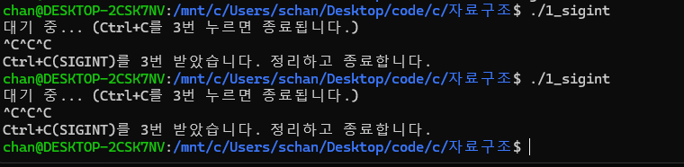
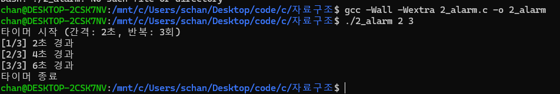
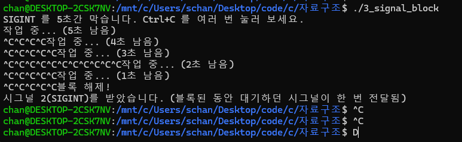

# 시스템프로그래밍 6주차 과제

**대구가톨릭대학교 컴퓨터공학과**  
**학번:** 25117261  
**이름:** 이세찬

## 1. 프로젝트 설명
이번 과제는 리눅스(Ubuntu) 환경에서 운영체제가 프로세스에 보내는 신호인 시그널을 다뤄본 실습입니다.

*   **`1_sigint.c`**: 터미널에서 Ctrl+C를 3번 눌러야만 꺼지게 만든 프로그램입니다. 핸들러 안에서는 복잡한 작업 대신 카운트만 올리도록 간단하게 짰습니다.
*   **`2_alarm.c`**: n초마다 알람이 반복해서 울리도록 만든 타이머입니다. `alarm` 함수는 한 번 울리고 끝나버려서, 핸들러 안에서 다시 알람을 걸어줘야 계속 반복된다는 것을 알게 되었습니다.
*   **`3_signal_block.c`**: 5초 동안 Ctrl+C를 막아두는 실습입니다. 시그널이 막힌 동안 아무리 여러 번 키를 눌러도, 나중에 차단이 풀렸을 때 딱 한 번만 전달된다는 점이 신기했습니다.

## 2. 실행 화면 캡처

### 1) 1_sigint 실행 화면

### 2) 2_alarm 실행 화면

### 3) 3_signal_block 실행 화면

## 3. AI 사용 관련 내용 및 본인의 보강 내용

*   **AI 활용 내역:**
    *   윈도우 컴파일러에서는 `sigaction` 같은 리눅스 전용 함수들이 에러가 나서, WSL(우분투) 터미널 환경을 세팅하고 CLion과 연동하는 과정에서 AI의 도움을 많이 받았습니다.
    *   시그널 핸들러 안에서는 `printf`를 쓰면 안 된다는 안전성(async-signal-safety) 규칙을 AI를 통해 배웠습니다.